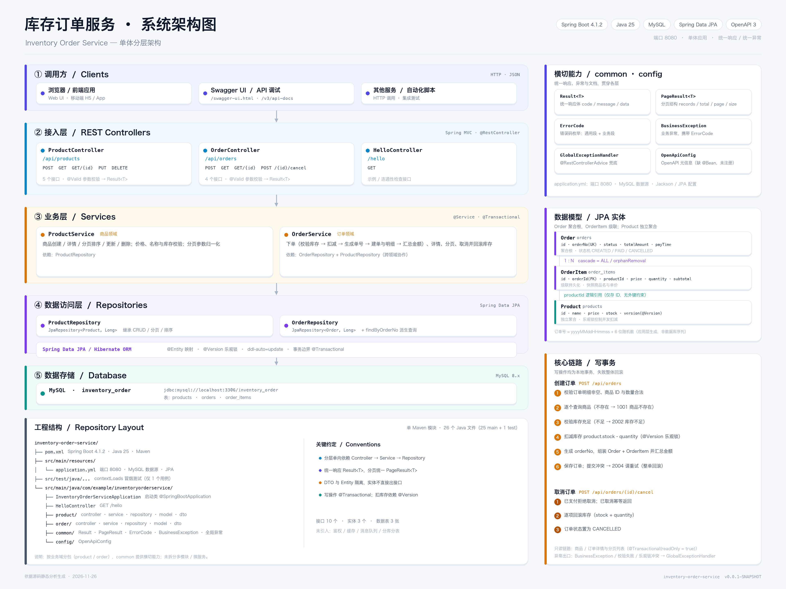
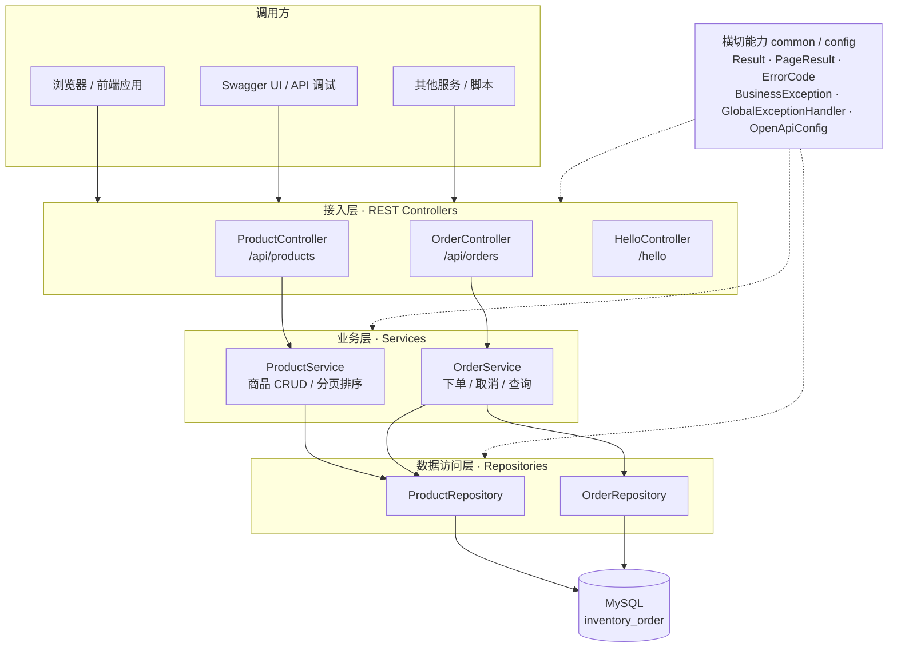
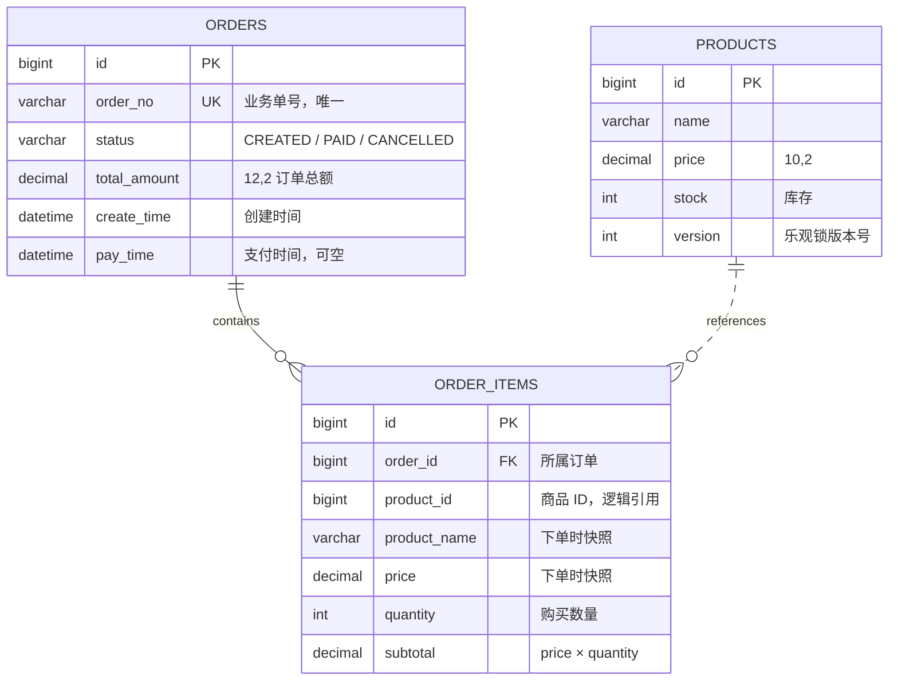
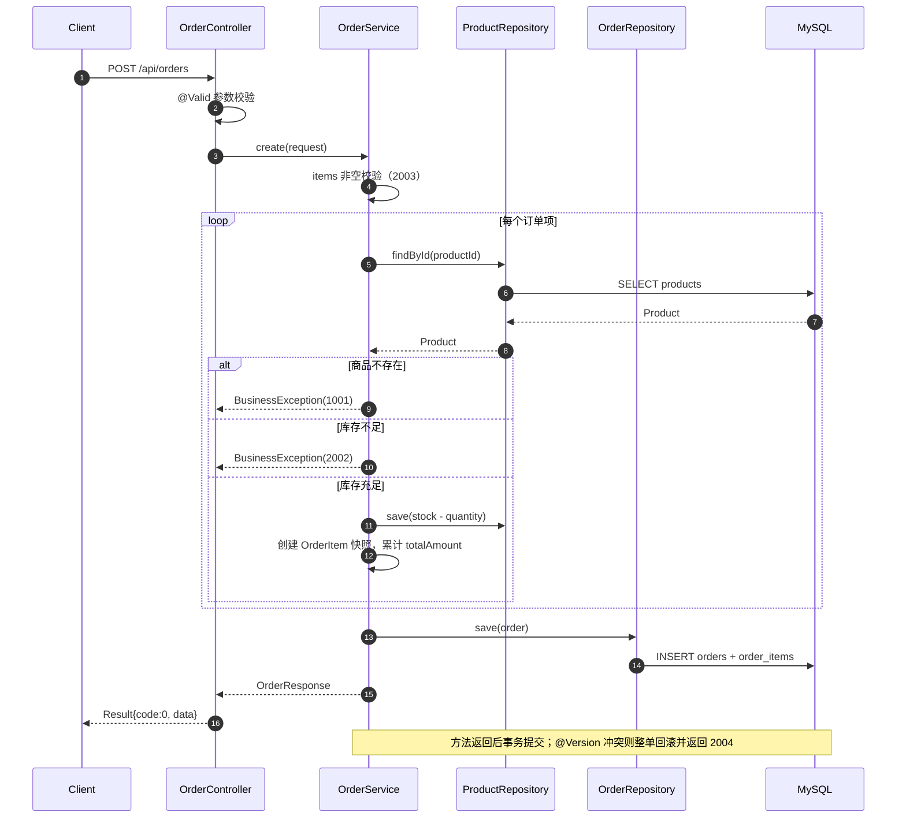
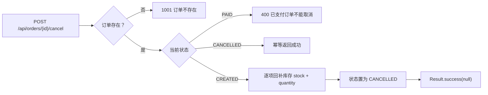

# 库存订单服务 · 架构分析

> 分析对象：`inventory-order-service`（本地非 Git 仓库，单 Maven 模块）
> 分析方式：全量源码静态阅读（25 个 main 源文件 + 1 个测试文件）
> 分析日期：2026-11-26



---

## 1. 项目定位

一个基于 **Spring Boot 4.1.2 / Java 25** 的单体 REST 服务，围绕「商品 Product — 订单 Order / OrderItem」两个业务域，提供商品增删改查、下单扣库存、订单查询与取消回补库存。整体是经典的**四层单体架构**：

```
调用方 → Controller → Service → Repository (JPA) → MySQL
```

统一响应、统一异常、分页结构与错误码收敛在 `common` 包，Swagger/OpenAPI 配置在 `config` 包。没有服务拆分、消息队列、缓存与鉴权，属于轻量业务骨架/示例工程。

| 项目 | 值 |
| --- | --- |
| 启动类 | [InventoryOrderServiceApplication.java](../src/main/java/com/example/inventoryorderservice/InventoryOrderServiceApplication.java) |
| 服务端口 | `8080` |
| 数据库 | MySQL `inventory_order`（`localhost:3306`） |
| 建表策略 | Hibernate `ddl-auto=update`（无迁移脚本） |
| API 文档 | springdoc-openapi：`/swagger-ui.html`、`/v3/api-docs` |
| 代码规模 | 10 个 REST 端点 · 3 个实体 · 3 张表 · 26 个 Java 文件 |

---

## 2. 技术栈

| 类别 | 选型 | 说明 |
| --- | --- | --- |
| 语言 / 运行时 | Java 25 | `pom.xml` 中 `java.version=25` |
| 框架 | Spring Boot 4.1.2 | `spring-boot-starter-parent` |
| Web | `spring-boot-starter-webmvc` | Spring MVC（Boot 4 的 starter 命名） |
| 持久化 | `spring-boot-starter-data-jpa` + Hibernate | 实体映射、派生查询、分页排序 |
| 数据库 | `mysql-connector-j`（runtime） | MySQL 驱动 |
| 参数校验 | `spring-boot-starter-validation` | Jakarta Bean Validation（`@Valid` / `@NotBlank` 等） |
| 接口文档 | `springdoc-openapi-starter-webmvc-ui` 3.2.1 | Swagger UI + OpenAPI 3 |
| 测试 | `spring-boot-starter-test` | 仅 1 个 `contextLoads` 冒烟测试 |

---

## 3. 架构总览

### 3.1 分层与依赖方向



关键点：

- **依赖单向**：`Controller → Service → Repository`，控制器不直接触碰仓储，实体不直接出接口。
- **订单域反向依赖商品域**：`OrderService` 同时注入 `OrderRepository` 与 `ProductRepository`，下单扣减、取消回补都在订单服务内完成。
- **库存与订单同库同事务**：一致性依赖本地事务，无分布式事务、无消息最终一致方案。

### 3.2 各层职责

| 层 / 组件 | 职责 | 关键类 |
| --- | --- | --- |
| 接入层 | 路由、参数绑定与校验、统一包装返回值 | [ProductController](../src/main/java/com/example/inventoryorderservice/product/controller/ProductController.java)、[OrderController](../src/main/java/com/example/inventoryorderservice/order/controller/OrderController.java)、[HelloController](../src/main/java/com/example/inventoryorderservice/HelloController.java) |
| 业务层 | 领域规则、事务边界、DTO 组装、库存扣减/回补 | [ProductService](../src/main/java/com/example/inventoryorderservice/product/service/ProductService.java)、[OrderService](../src/main/java/com/example/inventoryorderservice/order/service/OrderService.java) |
| 数据访问层 | 继承 `JpaRepository` 获得 CRUD/分页，少量派生查询 | [ProductRepository](../src/main/java/com/example/inventoryorderservice/product/repository/ProductRepository.java)、[OrderRepository](../src/main/java/com/example/inventoryorderservice/order/repository/OrderRepository.java) |
| 实体 / DTO | JPA 映射与接口出入参模型，静态工厂 `from()` 转换 | `model/*`、`dto/*` |
| 横切能力 | 统一响应 `Result<T>`、分页 `PageResult<T>`、错误码、业务异常、全局异常处理 | [common](../src/main/java/com/example/inventoryorderservice/common) |
| 配置 | OpenAPI 元信息（缺 `@Bean`，当前未生效）、数据源 / JPA 配置 | [OpenApiConfig](../src/main/java/com/example/inventoryorderservice/config/OpenApiConfig.java)、[application.yml](../src/main/resources/application.yml) |

---

## 4. 代码仓库结构

```
inventory-order-service/
├── pom.xml                              # Spring Boot 4.1.2 · Java 25 · Maven
├── mvnw / mvnw.cmd / .mvn/              # Maven Wrapper
├── HELP.md
├── inventory-order-service.iml / .idea/ # IntelliJ 工程文件
└── src/
    ├── main/
    │   ├── java/com/example/inventoryorderservice/
    │   │   ├── InventoryOrderServiceApplication.java   # @SpringBootApplication 启动类
    │   │   ├── HelloController.java                    # GET /hello
    │   │   ├── product/                                # 商品域
    │   │   │   ├── controller/ProductController.java
    │   │   │   ├── service/ProductService.java
    │   │   │   ├── repository/ProductRepository.java
    │   │   │   ├── model/Product.java
    │   │   │   └── dto/{ProductCreateRequest,ProductUpdateRequest,ProductResponse}.java
    │   │   ├── order/                                  # 订单域
    │   │   │   ├── controller/OrderController.java
    │   │   │   ├── service/OrderService.java
    │   │   │   ├── repository/OrderRepository.java
    │   │   │   ├── model/{Order,OrderItem,OrderStatus}.java
    │   │   │   └── dto/{OrderCreateRequest,OrderItemRequest,OrderResponse,OrderItemResponse}.java
    │   │   ├── common/                                 # 横切
    │   │   │   ├── Result.java
    │   │   │   ├── PageResult.java
    │   │   │   ├── ErrorCode.java
    │   │   │   ├── BusinessException.java
    │   │   │   └── GlobalExceptionHandler.java
    │   │   └── config/OpenApiConfig.java
    │   └── resources/application.yml                   # 端口 / 数据源 / JPA / Jackson
    └── test/java/com/example/inventoryorderservice/
        └── InventoryOrderServiceApplicationTests.java  # 仅 contextLoads()
```

分包策略是**按业务域分包**（`product` / `order`），域内再按 `controller / service / repository / model / dto` 分层，另有全局 `common` 与 `config`。这种结构在单体内聚性较好，后续若要拆微服务，`product` 与 `order` 两个包可以直接对应两个服务。

---

## 5. 数据模型



实体关系要点：

- `Order` 是聚合根（1 : N），`@OneToMany(mappedBy = "order", cascade = ALL, orphanRemoval = true)` 管理 `OrderItem`；保存订单时级联写入明细。
- `OrderItem` 通过 `@ManyToOne` 持有订单，同时以 `productId + productName + price` **快照**商品信息，因此商品改价/删除不影响历史订单展示（但取消订单回补库存时仍会按 `productId` 查商品，见 §9）。
- `Product` 是独立聚合，与订单明细之间**没有数据库外键**，只有 `productId` 弱引用。
- `Product.version` 使用 `@Version` 实现乐观锁，是当前防超卖的核心机制。
- 表名显式指定：`orders`（规避 SQL 关键字）、`order_items`、`products`。

> 订单号 = `yyyyMMddHHmmss` + 6 位随机数，应用层生成（[OrderService#generateOrderNo](../src/main/java/com/example/inventoryorderservice/order/service/OrderService.java)），非数据库序列。

---

## 6. API 一览

除 `/hello` 返回纯文本外，其余业务接口均返回统一结构 `Result<T>`，成功时 `code = 0`。

| # | 方法 | 路径 | 说明 | 入参 / 出参 |
| --- | --- | --- | --- | --- |
| 1 | POST | `/api/products` | 创建商品 | Body：`name`、`price`、`stock` → `ProductResponse` |
| 2 | GET | `/api/products/{id}` | 商品详情 | → `ProductResponse` |
| 3 | GET | `/api/products` | 商品分页列表 | `page=1&size=10&sortField=id&direction=asc` → `PageResult<ProductResponse>` |
| 4 | PUT | `/api/products/{id}` | 更新商品（名称/价格） | Body：`name?`、`price?` → `ProductResponse` |
| 5 | DELETE | `/api/products/{id}` | 删除商品 | → `null` |
| 6 | POST | `/api/orders` | 创建订单（扣库存） | Body：`items[{productId, quantity}]` → `OrderResponse` |
| 7 | GET | `/api/orders/{id}` | 订单详情 | → `OrderResponse`（含明细） |
| 8 | GET | `/api/orders` | 订单分页列表 | `page=1&size=10`，按 `createTime` 倒序 → `PageResult<OrderResponse>` |
| 9 | POST | `/api/orders/{id}/cancel` | 取消订单（回补库存） | → `null` |
| 10 | GET | `/hello` | 连通性示例 | → 纯文本 |

请求 / 响应示例（创建订单）：

```json
{ "items": [ { "productId": 1, "quantity": 2 } ] }
```

```json
{
  "code": 0,
  "message": "success",
  "data": {
    "id": 12,
    "orderNo": "20261126112333482913",
    "status": "CREATED",
    "totalAmount": 199.00,
    "createTime": "2026-11-26T11:23:33",
    "items": [
      { "productId": 1, "productName": "机械键盘", "price": 99.50, "quantity": 2, "subtotal": 199.00 }
    ]
  }
}
```

> `spring.jackson.default-property-inclusion: non_null`，为 `null` 的字段不会出现在 JSON 中。

---

## 7. 核心流程

### 7.1 创建订单（写事务）



设计意图：库存校验与扣减放在同一事务内，`Product` 的 `@Version` 在更新时校验版本号，冲突即回滚整单，从而避免超卖；代价是冲突时直接失败、没有重试。

### 7.2 取消订单



### 7.3 查询链路

商品/订单详情与分页列表均为 `@Transactional(readOnly = true)`，只读事务内完成实体到 DTO 的映射，不涉及锁。订单列表固定按 `createTime` 倒序。

---

## 8. 横切机制

### 8.1 统一响应与分页

- [`Result<T>`](../src/main/java/com/example/inventoryorderservice/common/Result.java)：`{ code, message, data }`，`success(data)` 固定 `code=0`、`message="success"`。
- [`PageResult<T>`](../src/main/java/com/example/inventoryorderservice/common/PageResult.java)：`{ records, total, page, size, totalPages }`，`page` 由 Spring Data 的 0 基页码 +1 转换。

### 8.2 错误码分段

| 段位 | 含义 | 已定义 |
| --- | --- | --- |
| 0 | 成功 | `SUCCESS(0)`（响应中硬编码，未引用枚举） |
| 4xx / 5xx | 通用错误 | `BAD_REQUEST(400)`、`NOT_FOUND(404)`（未使用）、`INTERNAL_ERROR(500)` |
| 1000 | 商品域 | `PRODUCT_NOT_FOUND(1001)`、`PRODUCT_PRICE_INVALID(1002)`（未使用） |
| 2000 | 订单域 | `ORDER_NOT_FOUND(2001)`、`ORDER_STOCK_NOT_ENOUGH(2002)`、`ORDER_ITEMS_EMPTY(2003)`、`ORDER_VERSION_CONFLICT(2004)` |

### 8.3 异常出口

[`GlobalExceptionHandler`](../src/main/java/com/example/inventoryorderservice/common/GlobalExceptionHandler.java)（`@RestControllerAdvice`）将异常统一转换为 `Result`：

| 异常 | 处理结果 |
| --- | --- |
| `BusinessException` | 返回其携带的 `ErrorCode` 与自定义 message |
| `MethodArgumentNotValidException` | 400 + 第一条字段校验消息 |
| `ObjectOptimisticLockingFailureException` | 2004「操作过于频繁，请重试」 |
| 其他 `Exception` | 500，记录 error 日志，不向前端泄露细节 |

---

## 9. 架构评价与改进建议

### 做得好的地方

1. **分层清晰、依赖单向**，按业务域分包，后续拆分服务成本低。
2. **事务边界规范**：类级 `@Transactional(readOnly = true)` + 写方法显式 `@Transactional`。
3. **统一响应 / 异常 / 错误码**集中治理，控制器代码干净。
4. **乐观锁防超卖**：`Product.@Version` + 本地事务回滚，是单库场景下的合理方案。
5. **DTO 与实体隔离**，用静态工厂 `from()` 转换，避免实体直接序列化带来的懒加载与字段泄露问题。

### 需要关注的问题（按优先级）

**高**

1. **数据库口令明文入库**：[application.yml](../src/main/resources/application.yml) 中直接写死账号口令，且 `useSSL=false`。建议改为环境变量 / 配置中心，并纳入密钥管理。
2. **`ddl-auto=update` 直接用于运行环境**：没有 Flyway/Liquibase 等版本化迁移，表结构变更不可追溯、不可回滚，多环境易漂移。建议生产改为 `validate` 并引入迁移脚本。
3. **下单无幂等保护**：客户端重复提交会生成多笔订单；订单号是时间戳 + 随机数，不具备业务幂等语义。建议引入幂等键（客户端 token / 业务唯一号）+ 唯一索引，或在下单前做去重校验。
4. **乐观锁异常捕获位置失真**：`create()` 里 `try/catch (ObjectOptimisticLockingFailureException)` 包住的是 `orderRepository.save(order)`，但 `Product` 的版本校验发生在**事务提交时**（方法返回之后），该 catch 基本不会命中；真正兜底的是 `GlobalExceptionHandler`。行为结果正确，但代码有误导性，且冲突后没有重试。建议显式 `flush` 或改为提交期统一处理，并考虑有限次重试/友好提示。

**中**

5. **取消订单存在并发重复回补风险**：`Order` 没有 `@Version`，两个并发取消可能都读到 `CREATED`，各自执行一次 `stock + quantity`。建议给 `Order` 加 `@Version`，或用 `UPDATE ... WHERE status='CREATED'` 条件更新保证只成功一次。
6. **商品被删除后订单无法取消**：取消时按 `productId` 查商品，`PRODUCT_NOT_FOUND` 会直接中断，历史订单变成“不可取消”。建议删除商品前校验未完成订单，或回补库存时容忍商品不存在并记录告警。
7. **支付链路缺失**：`OrderStatus.PAID` 与 `payTime` 没有任何写入入口，状态机只有 `CREATED → CANCELLED` 实际可用，`PAID` 分支实际是死代码。需补齐支付/发货状态流转与对应接口。
8. **库存只能被订单扣减，无法补货**：没有入库/盘点接口，也没有库存流水，库存变化不可审计、不可追溯。
9. **分页排序字段未做白名单**：`sortField` 直接传入 `Sort.by(...)`，非法字段会抛异常并落到 500；建议对允许排序的字段做白名单校验。
10. **分页边界不一致**：订单列表 `size >= 100` 会重置为 10，商品列表是 `size > 100` 才重置（即 100 合法）；建议抽出公共分页参数对象统一处理。
11. **自定义 OpenAPI 元信息未生效**：[OpenApiConfig](../src/main/java/com/example/inventoryorderservice/config/OpenApiConfig.java) 的方法缺少 `@Bean`，`OpenAPI` 实例不会被注册，Swagger 仍显示默认标题/描述。补上 `@Bean` 即可。
12. **订单列表 N+1 查询**：`Page<Order>.map(OrderResponse::from)` 会为每条订单懒加载 `items`，生成 1 + N 次查询。建议用 `@EntityGraph` / `join fetch` 或分页后批量抓取。
13. **死代码/冗余**：`ProductRepository.id(Long)` 方法未被使用且语义不明；`ErrorCode.PRODUCT_PRICE_INVALID`、`SUCCESS`、`NOT_FOUND` 未被引用；`HelloController` 与业务无关。

**低**

14. **鉴权与安全治理缺失**：无认证/授权、无限流、无审计日志；Swagger 在生产环境默认暴露。
15. **测试薄弱**：仅 `contextLoads()`，且依赖真实 MySQL 才能起上下文，没有单测 / 集成测试 / Testcontainers。
16. **实体上混入校验注解**：`Product` 上的 `@NotBlank` / `@Positive` 属于接口层约束，与 DTO 校验重复，边界略有混淆。
17. **工程化配套缺失**：非 Git 仓库、无 CI、无 Dockerfile、无 README/接口示例、`show-sql=true` 与 SQL 格式化会污染生产日志。

---

## 10. 结论

该项目是一个结构规整、可读性良好的 Spring Boot 单体示例：**分层明确、按域分包、统一响应与异常治理到位**，并用「本地事务 + 乐观锁」实现了最核心的防超卖逻辑，适合作为教学/起步骨架。

距离生产可用还差三块：**配置与密钥外置 + 版本化数据库迁移**（可运维性）、**幂等与状态机补全**（业务完整性）、**并发边界与测试覆盖**（可靠性）。建议按第 9 节的优先级逐项推进，其中「下单幂等」「取消订单并发」「支付状态机」是最值得优先补齐的业务缺口。
